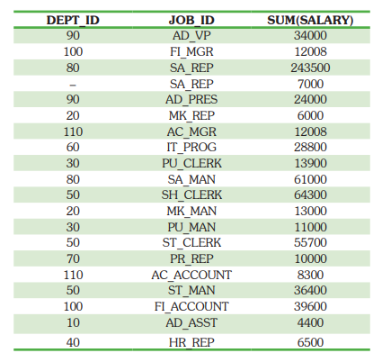
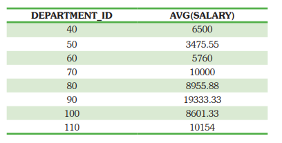
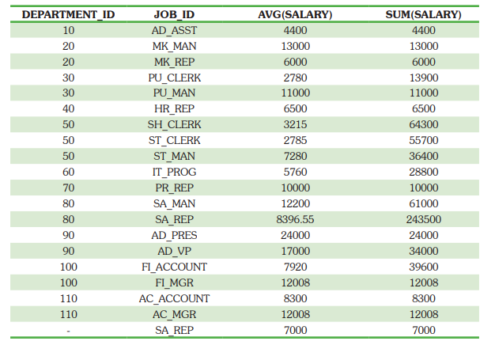
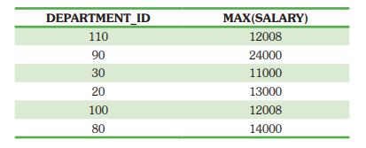
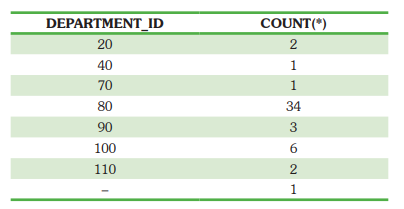

# Group By e Having

São duas cláusulas bastante poderosas e pouco usadas para se trabalhar com o `select`.

A `group by` organiza os dados da consulta em grupos com sumários e cláusula `having`
estabelece condições para listagem desesses grupos.

Como `where` está para `select`, `having` está para o `group by` em uso.

## Ordem de criação de um SELECT

- `select` - coluna(as)
- `from` - tabela(as)
- `where` - condição linha
- `group by` - colunas
- `having` - condição de grupo de linhas
- `order by` - colunas

## Funções de Grupo

A funções de grupo tem a funcionalidade de resumir informações.

| Função | Descrição                               |
| ------ | --------------------------------------- |
| SUM    | Retorna a soma de N                     |
| AVG    | Retorna a média aritimética de N        |
| COUNT  | Retorna o número de linhas das consulta |
| MAX    | Retorna o valor máximo de N             |
| MIN    | Retorna o valor mínimo de N             |

Todas as funções de grupos acima funcionam sobre um numero de linhas, como todas
as linhas de uma consulta por exemplo, por isso são chamadas funções de grupo.

Também existem modificadores como o `DISTINCT` que retorna a consulta sem duplicações e
o `ALL` que é o que vem por padrão.

Todas as funções menos o COUNT(*) aceita valores nulos.

Obetendo uma média dos salarios dos empregados.

```sql
select AVG(salary)
from EMPLOYEES; -- média dos salários
```

Obtendo o mínimo, o máximo e a soma dos salários dos empregados.

```sql
select MIN(salary), MAX(salary), SUM(salary)
from EMPLOYEES
where departament_id = 30;
```

Busque quantos empregrados são do departamento 30.

```sql
select count(*)
from EMPLOYEES
where departament_id = 30;
```

## Group By

Todos os campos do SELECT que não possuírem uma função de grupo DEVEM APARECER no group by.

Obtenha o id do departamento e média dos salários, utilizando o id do departamento como referência.

```sql
select departament_id, AVG(salary)
from HR."EMPLOYEES"
group by departament_id;
```

Porém os campos existentes na clásula `group by` não precisa aparecer no `select`

Obtenha a média de salário por departamento.

```sql
select AVG(salary)
from HR."EMPLOYEES"
group by departament_id;
```

### Agrupando mais que uma coluna

Esse agrupamento trará uma lista com a media dos departamentos por id e por tipo de trabalho.

```sql
select deapartament_id dept_id, job_id, sum(salary)
from employees
group by department_id, job_id;
```



É um pouco confuso, mas entendendo que será listado cada item do `group by` como uma
referência, fica mais simples. Por exemplo o departamento 90, repete mais de uma vez
pois possui mais de um tipo de trabalho dentro dele.

### Restrições

- Não se usa a cláusula `where` para restringir grupos e sim a `having`.
- Não se pode usar funções de grupos da cláusula `where`.

Para se fazer um query que utilize tanto o `where` comomo `group by`, será necessário
ser declaro nessa sequência:

```sql
select departament_id, avg(salary),
from employees
where departament_id not in (10, 20, 30) -- verificação entes do group by
group by departament_id -- agrupado por, para resolver o avg(*)
order by departament_id -- ordenação
```



Buscando a média salarial e soma dos salários por cada departamento e cargo.

```sql
select departament_id, job_id, avg(salary), sum(salary)
from employees
group by departament_id, job_id
order by deapartament_id
```



### Restringindo o resultado por grupo

Como já foi descrito nesse arquivo, para se restringir pesquisas baseado no resultado
do `group by` é necessário utilizar o `having`:

```sql
select departament_id, max(salary),
from employees
group by departament_id
having max(salary) > 10000;
```

O resultado será filtrará pelos departamentos com o salário máximo maior que 10000.



#### HAVING

Usada para fazer validações em resultado baseados em `group by` e funções de grupo. Ex: `AVG`, `MAX` e `SUM`.

Contando a quantidade de empregados que tenha o salário acima de 10000 por departamento.

```sql
select departament_id, count(*),
from employees
group by departament_id
having max(salary) > 10000
order by departament_id
```


